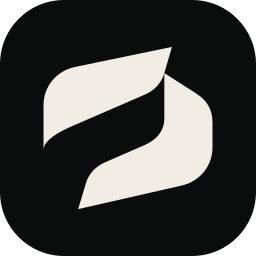

<p align="center"></p>
<p align="center"><a href="https://twofold.fractal-tess.xyz/"></a></p>
<h1 align="center">Twofold</h1>
<p align="center"></p>
<p align="center">The portfolio of Vilian Gerdzhikov and Plamen Ermenkov.</p>

A small studio site showing our projects, capabilities and team. Built with React and Vite+, with server-rendered Bulgarian and English pages, a page for each project and an optional WebGL background in the hero on larger screens.

```sh
vp install
vp dev
vp build
vp run start
```

Visiting `/` follows the browser language; the EN/BG switch remembers an explicit choice and keeps you on the same page. Each project has its own page at `/en/work/<project>` and `/bg/work/<project>`.

[Development, tests and deployment](CONTRIBUTING.md) · [Live site](https://twofold.fractal-tess.xyz/)

Based on the licensed React Bits Pro Agency template. Keep this repository private; see [LICENSE](LICENSE). Project screenshots come from the project repositories and Vilian's portfolio.
